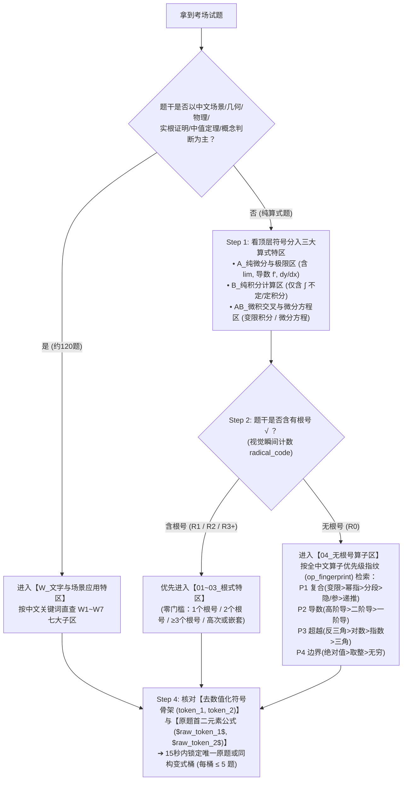

# 📘 高等数学原题开卷考试速查手册 · 结构化题库数据底座

[](https://creativecommons.org/licenses/by-nc-nd/4.0/deed.zh-hans)
[](#三-仓库目录结构与数据规模)
[-100.0%25-brightgreen.svg)](#二-核心特性与检索架构设计)
[-purple.svg)](#四-如何使用本仓库)

> **定位**：本仓库是专为制作**《高等数学原题开卷考试速查手册》**而构建的**单一事实数据源（Single Source of Truth, SSOT）**与 Obsidian 知识图谱仓库。
> 全库完整收录《高等数学 习题全解与学习指导（上册·第2版·微课版）》（张弢、殷俊锋编，人民邮电出版社）第 1～4 章共 **25 个小节、972 道独立原子题卡**，并配套构建了**多维视觉拓扑字典索引**、**4 份考场急救/秒杀速查表**以及面向下游自动化排版引擎的**《给后续接管智能体的说明》**。

---

## 一、 为什么构建这个项目？（双轨赋能设计理念）

针对高校《高等数学》开卷/半开卷考试中常见的 **“70% 题库原题直出 + 30% 换数字/同构变式题”** 命题规律，传统按教材章节顺序排版的辅导书在考场上存在致命痛点：
- **对数学零基础者（如初中毕业、中考数学 60/120 水平）**：看不懂高数专业术语，分不清这道题属于“第二章导数”还是“第三章积分”，按目录翻书如同大海捞针；即便翻到原题或变值题，也常因忘记 $\sin\frac{\pi}{6}$、$\ln 1$ 或不会把 $\frac{1}{\sqrt{x}}$ 写成 $x^{-1/2}$ 而卡在最后一步。
- **对懂数学的进阶考生**：传统题海缺乏按“算子组合与代数骨架”的横向聚类，遇到改了常数的 30% 变式题时仍需现场从头推导，浪费宝贵的考场时间。

为此，本仓库从底层数据结构上实现了**“零基础保命”与“高手如虎添翼”的双轨统一**：

| 目标群体 | 应对考题比例 | 核心痛点 | 本仓库提供的工程化解决方案 |
| :--- | :---: | :--- | :--- |
| **零高数基础考生**<br>*(初中数学 60/120 水平)* | **70% 原题直出**<br>+ 基础变值题 | 不懂高数概念、看不懂英文缩写、算不出特殊常数 | 1. **四大检字特区 + 根式优先路由**：先看题干汉字进 `W_文字特区`，或直接数根号个数（`R1/R2/R3+`）进根式特区，无需高数背景。<br>2. **全中文算子名称**：彻底废除 `trig/exp/arc/D1` 等英文代号，统一使用 `三角`、`指数`、`反三角`、`一阶导` 等直观中文。<br>3. **索引表 `$...$` 公式真渲染**：所见即所得，看题目外貌长相 15 秒锁定原题并照抄采分步骤。<br>4. **配套《救命特殊值全表》与《初中代数急救小抄》**：查表即得特殊角、指对数与根式转换结果。 |
| **懂高数的进阶考生**<br>*(冲刺高分/满分)* | **30% 变值/变式题**<br>+ 综合压轴题 | 题目改了常数或系数、现场推导耗时易错 | 1. **去数值化符号骨架聚类 (`token_1`, `token_2`)**：将 $4y''+4y'+y=0$ 与 $y''-6y'+9y=0$ 自动归一化为同一骨架 `ay''\pm by'\pm cy=0`，使所有换数字的同构题在物理空间上紧挨在一起。<br>2. **配套《变值题换数字直接套·含参通用公式全表》**：提炼带参数 $a, b, k, n$ 的通用结果公式，把考卷新数字代入即出答案。<br>3. **配套《高手秒杀四大件》**：高阶泰勒展开秒杀印章、分部积分“反对幂指三”表格法、华里士点火公式、常系数非齐次特解待定速查表。 |

---

## 二、 核心特性与检索架构设计

### 1. 原子级题卡拆解（972 张独立 `.md` 题卡）
- **无关联小题彻底拆分**：凡一大题内包含多个无语义关联的独立计算小题（如“求下列函数的导数 (1)～(20)”），全部拆分为独立 `.md` 文件（如 `习题2-2-02-01.md`），确保每张题卡拥有纯粹、唯一的算子指纹。
- **递进关联多问保持完整**：凡共享同一题干背景、前后小问存在强语义递进关联的综合题，保留在同一 `.md` 文件内，确保解答上下文完整。

### 2. 四步视觉拓扑与全中文算子路由算法（100% 桶容量 $\le 5$）
每道题卡均通过自动化 AST/正则流水线提取多维结构特征，将 972 道题精准散列至 **816 个粗粒度桶 / 950 个细粒度桶**，**单桶题目数 $1 \le m \le 5$ 的达标率高达 100.0%**（彻底杜绝大桶翻找）：



### 3. 去数值化符号骨架（De-numeralized Skeleton）双轨机制
为了同时满足“原题核对具体数字”与“变值题跨题聚类”，每张题卡在 YAML 中同时维护两套首二元素：
- **原题真值 (`raw_token_1`, `raw_token_2`)**：保留原题具体常数（如 `\sqrt{4-x^2}`、`4y''+4y'+y`、`x\to 2`），在索引表中以 `$...$` 渲染为真数学公式，方便考生肉眼核对原题。
- **去数值化符号骨架 (`token_1`, `token_2`)**：将非结构性常数自动归一化为符号参数（如将 `\sqrt{4-x^2}` 与 `\sqrt{9-x^2}` 统一为 `\sqrt{a^2-x^2}`，将 `x\to 2` 统一为 `x\to a`），作为底层聚类键。

### 4. 下游“分类即正文”印刷排版原生就绪 (`dict_sort_key`)
本仓库不仅可在 Obsidian 中交互检索，更是为下游 Typst / LaTeX 自动化排版智能体准备的结构化数据库。每张题卡均包含 **16 个标准化 YAML Frontmatter 字段**（含全局唯一印刷排序键 `dict_sort_key`）。下游排版程序只需按 `dict_sort_key` 升序遍历全部 `.md` 文件，即可直接生成**“分类目录即题卡正文、无需二次翻页查题号”**的纸质速查手册。详细字段规范见 [`给后续接管智能体的说明.md`](./给后续接管智能体的说明.md)。

---

## 三、 仓库目录结构与数据规模

```text
高等数学手册/
├── README.md                                  # 项目说明文档（本文档）
├── LICENSE                                    # CC BY-NC-ND 4.0 国际许可协议
├── 欢迎.md                                    # Obsidian 仓库门户首页与快速导航
├── 习题总索引.md                              # 全库 972 题四维检字字典总控台（100% 图谱全连接）
├── 给后续接管智能体的说明.md                   # 下游排版/开发智能体的数据字典与接管规范说明书
│
├── 00_考场速查表与公式库/                      # 【考场急救与秒杀工具包】（共 4 份核心速查表）
│   ├── 01_救命特殊值全表_三角反三角指对数与根式转换.md
│   ├── 02_变值题换数字直接套_含参通用公式全表.md
│   ├── 03_高手秒杀四大件_等价泰勒_反对幂指三_点火公式_微分方程特解.md
│   └── 04_初中代数与几何急救小抄_因式分解_三角恒等式_面积体积公式.md
│
├── 第一章_函数极限与连续/                      # 【第 1 章】7 个小节，共 189 道独立原子题卡
│   ├── 第一章_习题索引.md
│   └── 习题1-1_集合与函数/ ... 习题1-7_函数的连续性及其性质/
│
├── 第二章_一元函数微分学及其应用/              # 【第 2 章】7 个小节，共 331 道独立原子题卡
│   ├── 第二章_习题索引.md
│   └── 习题2-1_导数的概念及基本求导公式/ ... 习题2-7_微分学的实际应用/
│
├── 第三章_一元函数积分学及其应用/              # 【第 3 章】8 个小节，共 333 道独立原子题卡
│   ├── 第三章_习题索引.md
│   └── 习题3-1_不定积分的概念与性质/ ... 习题3-8_反常积分/
│
└── 第四章_微分方程/                            # 【第 4 章】4 个小节，共 119 道独立原子题卡
    ├── 第四章_习题索引.md
    └── 习题4-1_微分方程的基本概念/ ... 习题4-4_微分方程的实际案例/
```

### 各章题卡分布统计

| 章节 | 涵盖小节范围 | 独立原子题卡数 | 核心题型覆盖 |
| :--- | :---: | :---: | :--- |
| **第一章 函数、极限与连续** | 习题 1-1 ～ 习题 1-7 + 总习题一 | **189 题** | 定义域与复合函数、数列与函数极限、无穷小等价代换、两个重要极限、连续性与间断点、零点定理 |
| **第二章 一元函数微分学及其应用** | 习题 2-1 ～ 习题 2-7 + 总习题二 | **331 题** | 导数定义、复合/隐函数/参数方程/对数/高阶求导、微分、罗尔/拉格朗日/柯西中值定理、洛必达法则、单调性极值凹凸性、切线曲率与优化应用 |
| **第三章 一元函数积分学及其应用** | 习题 3-1 ～ 习题 3-8 + 总习题三 | **333 题** | 不定积分第一/第二换元法与分部积分、有理分式与三角有理式积分、变上限积分求导、牛顿-莱布尼茨公式、反常积分、平面面积/旋转体体积/弧长/物理做功 |
| **第四章 微分方程** | 习题 4-1 ～ 习题 4-4 + 总习题四 | **119 题** | 可分离变量、齐次方程、一阶线性微分方程、伯努利方程、可降阶二阶方程、二阶常系数齐次与非齐次线性微分方程、几何与物理动力建模 |
| **全库合计** | **共 25 个小节单元** | **972 题** | **100% 完整覆盖教材与学习指导全部习题及解析** |

---

## 四、 如何使用本仓库？

### 方式一：使用 Obsidian 作为电子交互式速查库（推荐）
1. 克隆或下载本仓库到本地：
   ```bash
   git clone https://github.com/CheeseGhostfox/Higher-Mathematics-OpenBook-Dictionary.git
   ```
2. 打开 [Obsidian](https://obsidian.md/)，选择 **“打开本地仓库（Open folder as vault）”** 并选中本仓库根目录。
3. 打开 [`欢迎.md`](./欢迎.md) 或 [`习题总索引.md`](./习题总索引.md)：
   - **按试卷题目长相查题**：直接查看 [`习题总索引.md`](./习题总索引.md) 第四节《四大检字特区与根式优先混合路由表》，或使用 `Ctrl + F` 搜索中文算子（如 `变限·三角`、`R2(嵌套)`）。
   - **按多维标签过滤**：在 Obsidian 左侧标签面板中组合点击 `#lookup_zone/B_纯积分计算区`、`#radical/R1`、`#op/三角` 等标签，瞬间筛出目标题卡。
   - **关系图谱（Graph View）**：全库 972 张题卡、4 份章节索引、4 份速查表与总索引已实现 **100% 双向 WikiLink 连通（0 孤立节点）**。

### 方式二：作为下游 PDF / Typst / LaTeX 印刷排版的数据底座
如果你正在使用 AI 智能体或自动化脚本将本仓库编译为可打印的纸质速查手册，请直接让智能体首先阅读根目录下的 **[`给后续接管智能体的说明.md`](./给后续接管智能体的说明.md)**。该文档提供了完整的 YAML Schema、16 个字段说明及 Python 读取排序示例代码。

---

## 五、 质量审计指标（Automated Quality Audits）

本仓库所有题卡与索引均通过自动化校验流水线审计，核心指标如下：
- **[Audit 1] YAML 反斜杠转义合规率**：`100%`（0 语法错误，全部采用单引号安全包裹 LaTeX 源码）
- **[Audit 2] Markdown 索引表格列完整性**：`100%`（0 断列，表格内绝对值竖线 `|` 已全部转义为 `\vert`）
- **[Audit 3] Obsidian 标签合法性**：`100%`（0 非法字符）
- **[Audit 4 & 5] 粗/细粒度桶超载数（$>6$ 题）**：`0 个`
- **[Audit 6 & 7] 检索桶容量 $1 \le m \le 5$ 达标率**：**`100.0%`**（粗粒度 816/816 桶，细粒度 950/950 桶）
- **[Audit 8] 首数学元素停用词剥壳纯净度**：`100%`（0 口水词残留）
- **[Audit 9] Obsidian 图谱孤立节点数**：`0 个`

---

## 六、 许可协议（License）

本项目采用 **[CC BY-NC-ND 4.0（知识共享 署名-非商业性使用-禁止演绎 4.0 国际许可协议）](https://creativecommons.org/licenses/by-nc-nd/4.0/deed.zh-hans)** 进行许可。

- **署名（BY）**：您必须给出适当的署名，提供指向本许可协议的链接，同时标明是否做出了更改。
- **非商业性使用（NC）**：您不得将本作品用于商业目的。
- **禁止演绎（ND）**：如果您再混合、转换或者基于本作品进行创作，您不可以分发修改后的作品。

完整法律文本请参阅仓库根目录下的 [`LICENSE`](./LICENSE) 文件。
